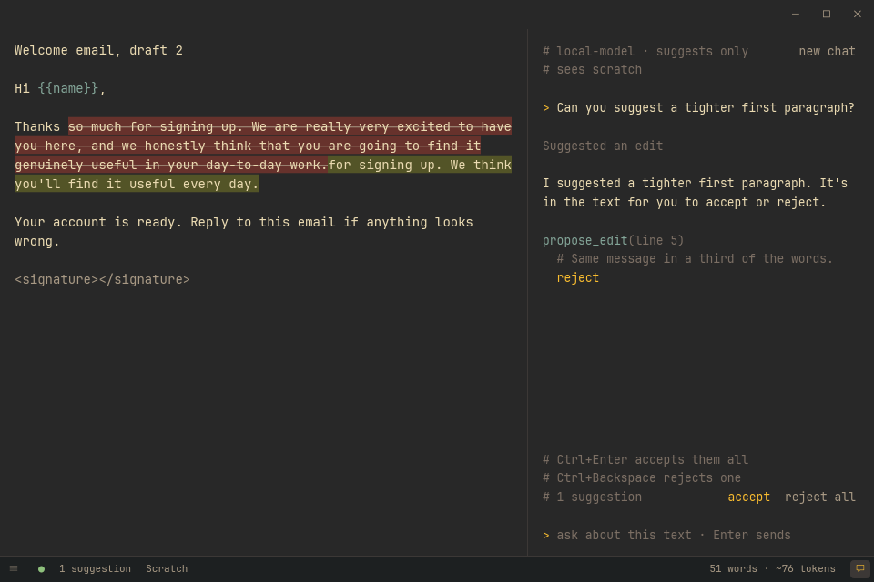

<p align="center">
  
</p>

# Dovetail

A plain-text editor and scratchpad for Linux, macOS and Windows. It starts fast, saves as you
type, and stays out of the way.

Open it and you get the scratchpad, with your text, cursor and undo history right where you left
them. Open a file instead (`dovetail notes.txt`) and you get that. Every launch is its own window,
which suits a tiling window manager. There is no save prompt, because there is no unsaved state.

It colours Markdown, JSON, YAML, TOML, INI, shell scripts and SSH config, and tells you in the
status bar where a data or config file stops being valid. It never changes your text to do it.

It opens files on your SSH hosts as well (`Ctrl+O`, then `ssh:`), and saves them back so that a
dropped connection never costs you text.

There is also an assistant pane (`Ctrl+L`) that reads your text and suggests edits you can accept
or reject. It talks to any OpenAI-compatible server you point it at, and the editor works fine
without it.

<p align="center">
  
</p>

> [!WARNING]
> This is still a work in progress. Things change and break. Keep backups of anything important.

## Install

You build it from this repo. You need Git and [Rust](https://rustup.rs), plus a few extra things on
each OS, which are listed in the [guide](docs/guide.md#install).

```sh
git clone https://github.com/cavecomputing/dovetail.git
cd dovetail
scripts/install.sh            # Linux
scripts/install-macos.sh      # macOS
```

On Windows, run this in PowerShell from the `dovetail` folder:

```powershell
powershell -ExecutionPolicy Bypass -File scripts\install-windows.ps1
```

The first build takes a few minutes. To update, `git pull` and run the script again. Your settings
and scratchpad are kept.

Arch users can build a package instead (`cd packaging/arch && makepkg -si`), and macOS has a
ready-made app on the [releases page](https://github.com/cavecomputing/dovetail/releases).

## Keys

| Key | What it does |
|---|---|
| Ctrl+N | New file |
| Ctrl+O | Open a file |
| Ctrl+P | Scratch and recent files |
| Ctrl+Shift+P | Tools for the open file (format JSON, and so on) |
| Ctrl+F | Find |
| Ctrl+Shift+F | Find and replace |
| Ctrl+S | Save now (in scratch, save it to a file) |
| Ctrl+L | Show or hide the assistant |
| Ctrl+, | Settings |

On a Mac, use ⌘ instead of Ctrl. The full list is in the [guide](docs/guide.md#keys).

## More

- [Guide](docs/guide.md): installing on each OS, every key, saving, the assistant and every setting.
- [Design](docs/spec.md): what it's meant to be.

MIT licensed, see [LICENSE](LICENSE). It bundles JetBrains Mono NL Nerd Font under the SIL Open
Font License, see [assets/fonts/OFL.txt](assets/fonts/OFL.txt).
