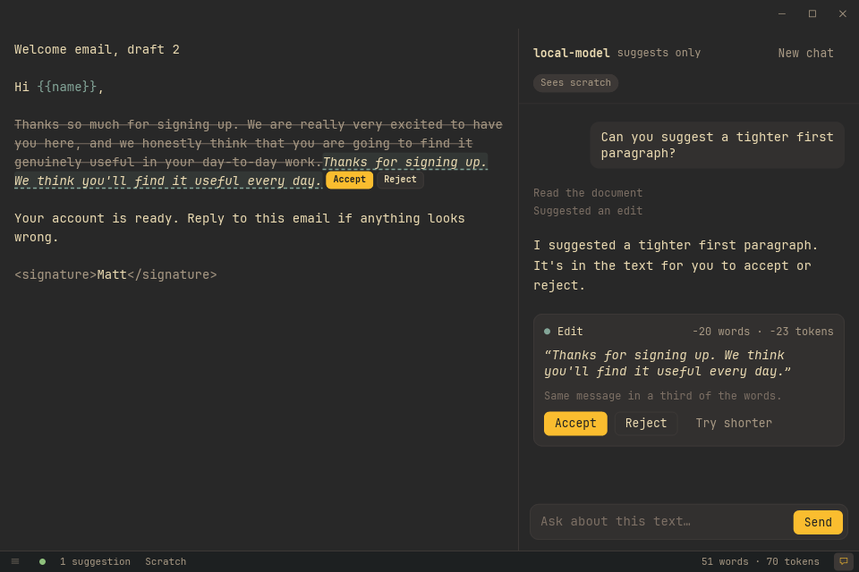

<p align="center">
  
</p>

<p align="center">
  A fast, quiet text editor and scratchpad, with an assistant that suggests edits ✍️
</p>

Dovetail is a plain-text editor for writing notes, drafts and prompts. Open it and you're straight
into a scratchpad that remembers exactly where you left off. Each launch gets its own window, and
opening another file from inside one swaps it in, once the one you're leaving is saved. Everything
saves itself as you type, so there's no "save changes?" prompt, ever.

Markdown, JSON, YAML, TOML and INI files are coloured as you type (the text stays exactly as you
wrote it), and the data and config files are checked too: the status bar says where one stops
being valid. JSON files can be formatted or minified from the command palette.

There's also an optional assistant pane. Ask it about your text and it suggests edits right in the
document, with the old words struck through and the new ones beside them, for you to accept or
reject. It never changes your text on its own.

**Dovetail is not the AI.** It doesn't include a model or do any of the thinking itself. You point
it at an AI service you already have: a paid one online (OpenAI, OpenRouter and similar), or one
running on your own computer (Ollama, LM Studio, llama.cpp). Almost all of them work, because they
speak the same "OpenAI-style" language Dovetail expects. The editor works fine without one.

<p align="center">
  
</p>

> [!WARNING]
> Dovetail is a work in progress. It's usable day to day, but things still change, break and get
> moved around. Keep anything important backed up somewhere else too.

## Quick start

Dovetail is built on your own computer from this repository. You need Git and
[Rust](https://rustup.rs) installed first (the [guide](docs/guide.md#install) lists the few extra
bits each OS needs).

```sh
git clone https://github.com/cavecomputing/text.git
cd text
scripts/install.sh            # Linux
scripts/install-macos.sh      # macOS
```

On Windows, in PowerShell inside the `text` folder:

```powershell
powershell -ExecutionPolicy Bypass -File scripts\install-windows.ps1
```

The first build takes a few minutes. After that, start Dovetail from your app launcher (or Start
Menu), or from a terminal:

```sh
dovetail              # opens the scratchpad
dovetail notes.txt    # opens a file
```

Linux comes first. macOS and Windows work too, but get less use.

## Setting up the assistant

1. Open Settings with `Ctrl+,` (`⌘,` on a Mac).
2. Under **Assistant**, enter the **Base URL** for your AI service. Some common ones:

   | Service | Base URL | Request format |
   |---|---|---|
   | OpenAI | `https://api.openai.com/v1` | responses |
   | OpenRouter | `https://openrouter.ai/api/v1` | chat completions |
   | Ollama | `http://localhost:11434/v1` | chat completions |
   | LM Studio | `http://localhost:1234/v1` | chat completions |
   | llama.cpp | `http://localhost:8080/v1` | chat completions |

3. Enter the **Model** name and, if your service needs one, an **API key**.
4. Press **Test connection**.
5. Press `Esc` to close Settings, then `Ctrl+L` to open the assistant pane.

The model has to support tools (sometimes called function calling), because that's how it reads
your text and suggests edits. Test connection will tell you if it doesn't.

## Handy keys

| Key | What it does |
|---|---|
| Ctrl+N | New file |
| Ctrl+O | Open a file |
| Ctrl+P | Scratch and the recent files |
| Ctrl+Shift+P | The open file's tools (Format and Minify JSON) |
| Ctrl+F | Find |
| Ctrl+Shift+F | Find and replace |
| Ctrl+S | Save now (in the scratchpad, save it to a file) |
| Ctrl+L | Show or hide the assistant |
| Ctrl+, | Settings |

On a Mac, use ⌘ instead of Ctrl. The full list is in the [guide](docs/guide.md#keys).

## Updating

Run `git pull` in the `text` folder, then the same install script again. Your settings, scratchpad
and API key are kept.

## More

- [The guide](docs/guide.md): installing on each OS, every key, how saving works, the assistant in
  detail, every setting, and working on the code.
- [The design](docs/spec.md): what Dovetail is meant to become.

Dovetail is MIT licensed: see [LICENSE](LICENSE). It bundles JetBrains Mono NL Nerd Font, under
the SIL Open Font License: see [assets/fonts/OFL.txt](assets/fonts/OFL.txt).
